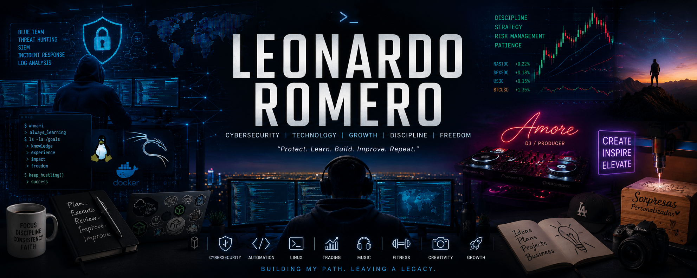

  

<h3 align="center">SOC Analyst • Blue Team • Incident Response • Digital Forensics</h3>

---

<h2 align="center">Who Am I</h2>

Cybersecurity student focused on **Security Operations**, **Blue Team**, **Threat Detection**, and **Incident Response**.

I enjoy building realistic investigations, documenting every finding, and turning hands-on labs into professional case studies.

My goal is to become a SOC Analyst capable of detecting, investigating, and responding to real-world attacks.

---

<h2 align="center">🏆 Top Projects</h2>

<table align="center">
<tr>
<td width="33%" valign="top" align="center">
<h3>1st Place</h3>

<h3>Vértice Pharmaceutics End-to-End Investigation</h3>

Incident-response case file with an evidence-based timeline, impact assessment, and containment/remediation plan.

<b>Skills</b> 
Incident Response • DFIR • Timeline Analysis • Impact Assessment • Remediation
</td>
<td width="33%" valign="top" align="center">
<h3>2nd Place</h3>

<h3>Cloud Incident Response</h3>

AWS incident response and detection labs with a ransomware case study.

<b>Skills</b> 
AWS Incident Response • CloudTrail & Config • IAM / S3 / RDS / EC2 (IMDS) • Detection Engineering
</td>
<td width="33%" valign="top" align="center">
<h3>3rd Place</h3>

<h3>QuantiaPay Incident Response</h3>

Cloud CI/CD compromise investigation.

<b>Skills</b> 
Incident Response • DFIR • MITRE ATT&CK • IOC Analysis • Timeline Analysis
</td>
</tr>
</table>

---

<h4 align="center">🎓 Certifications</h4>

<table align="center">
<tr>
<td align="center" valign="middle" width="33%">

</td>
<td align="center" valign="middle" width="33%">

</td>
<td align="center" valign="middle" width="33%">

</td>
</tr>
</table>

---

<h2 align="center">Blue Team Student Handbook</h2>

🛡️ <b>SOC Analyst Playbooks</b> • 🔍 <b>Investigation Guides</b> • 📋 <b>Case Documentation</b> • 🎓 <b>Student Resources</b>

---

<h2 align="center">Featured Investigations</h2>

<table>
<tr>
<td width="50%" valign="top">

<h3>Cloud Incident Response</h3>

AWS incident response and detection labs with a ransomware case study.

<b>Skills</b>

- AWS Incident Response
- CloudTrail & Config
- IAM / S3 / RDS / EC2 (IMDS)
- Detection Engineering
- Ransomware Case Study
</td>
<td width="50%" valign="top">

<h3>Phishing: How They Attack Us and How We Defend Ourselves</h3>

Awareness campaign and hands-on phishing analysis project.

<b>Skills</b>

- Phishing Analysis
- Email Investigation
- Security Awareness
- IOC Analysis
- Defensive Strategies
</td>
</tr>
<tr>
<td width="50%" valign="top">

<h3>QuantiaPay Incident Response</h3>

Cloud CI/CD compromise investigation.

<b>Skills</b>

- Incident Response
- DFIR
- MITRE ATT&CK
- IOC Analysis
- Timeline Analysis
</td>
<td width="50%" valign="top">

<h3>NorthBay Logistics Investigation</h3>

SOC correlation investigation.

<b>Skills</b>

- Alert Correlation
- MITRE ATT&CK
- Executive Reporting
- IOC Analysis
- Threat Investigation
</td>
</tr>
<tr>
<td width="50%" valign="top">

<h3>Liberty & Co. Enterprise Assessment</h3>

Enterprise security assessment and incident response.

<b>Skills</b>

- Security Assessment
- Incident Response
- Risk Analysis
- MITRE ATT&CK
- Technical Reporting
</td>
<td width="50%" valign="top">

<h3>NorthBridge Manufacturing Investigation</h3>

Lateral movement investigation across an enterprise Windows environment.

<b>Skills</b>

- Lateral Movement Analysis
- Incident Response
- Windows Event Logs
- MITRE ATT&CK
- Threat Investigation
</td>
</tr>
<tr>
<td colspan="2" align="center" valign="middle">
<h3>🚧 New Projects Coming Soon</h3>

<i>More investigations, case studies, and labs are on the way. Stay tuned!</i>
</td>
</tr>
</table>

---

<h2 align="center">Technical Stack</h2>

---

<h2 align="center">Investigations Overview</h2>

<table align="center">
<tr>
<th align="center">Investigation</th>
<th align="center">Skills</th>
</tr>
<tr>
<td align="center"><a href="https://github.com/ravesnoopy/End-To-End-Investigation-Vertice-Pharmaceutics">Vértice Pharmaceutics End-to-End Investigation</a></td>
<td align="center">Incident Response • DFIR • Timeline Analysis • Remediation</td>
</tr>
<tr>
<td align="center"><a href="https://github.com/ravesnoopy/cloud-incident-response">Cloud Incident Response (AWS)</a></td>
<td align="center">CloudTrail • IAM • Detection Engineering • Ransomware</td>
</tr>
<tr>
<td align="center"><a href="https://github.com/ravesnoopy/QuantiaPay-Incident-Response">QuantiaPay Incident Response</a></td>
<td align="center">DFIR • Timeline Analysis • Evidence Collection</td>
</tr>
<tr>
<td align="center"><a href="https://github.com/ravesnoopy/-Phishing-How-They-Attack-Us-and-How-We-Defend-Ourselves-">Phishing Analysis Project</a></td>
<td align="center">Email Investigation • IOC Analysis • Security Awareness</td>
</tr>
<tr>
<td align="center"><a href="https://github.com/ravesnoopy/SOC-Investigation-NorthBay">NorthBay Logistics Investigation</a></td>
<td align="center">Alert Correlation • MITRE ATT&CK • Executive Reporting</td>
</tr>
<tr>
<td align="center"><a href="https://github.com/ravesnoopy/Liberty-Co.-Enterprise-Security-Assessment-Incident-Response">Liberty & Co. Enterprise Assessment</a></td>
<td align="center">Security Assessment • Risk Analysis • Technical Reporting</td>
</tr>
<tr>
<td align="center"><a href="https://github.com/ravesnoopy/NorthBridge-Manufacturing-Lateral-Movement-Investigation">NorthBridge Manufacturing Investigation</a></td>
<td align="center">Lateral Movement • Windows Event Logs • MITRE ATT&CK</td>
</tr>
<tr>
<td align="center">Windows Event Log Analysis</td>
<td align="center">Sysmon • Event Viewer • IOC Detection</td>
</tr>
<tr>
<td align="center">Threat Hunting Lab</td>
<td align="center">MITRE ATT&CK • Sigma • Detection Logic</td>
</tr>
<tr>
<td align="center">Network Investigation</td>
<td align="center">Wireshark • PCAP Analysis</td>
</tr>
<tr>
<td align="center">Linux Hardening</td>
<td align="center">SSH • Permissions • Services</td>
</tr>
</table>

---

<h2 align="center">GitHub Analytics</h2>

---

<h2 align="center">Cybersecurity Roadmap</h2>

✅ Networking Fundamentals  
✅ Linux  
✅ Windows  
✅ Digital Forensics  
✅ Incident Response  
✅ Detection Engineering  
✅ Malware Analysis  
✅ Threat Intelligence  
✅ Cloud Security  
✅ SOC Analyst L1

---

<h2 align="center">Connect</h2>

<table align="center">
<tr>
<td align="center" valign="middle" width="33%">

  
<b>LEONARDO ROMERO</b>
</td>
<td align="center" valign="middle" width="34%">
<h3>SOC ANALYST</h3>
<b>SEARCHING OPPORTUNITIES</b>
</td>
<td align="center" valign="middle" width="33%">

  
<b>UKIYO1000</b>
</td>
</tr>
</table>
